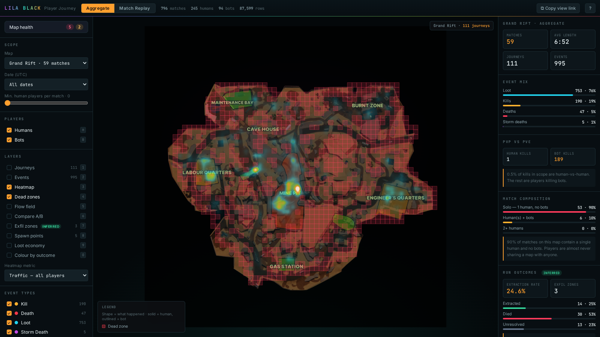
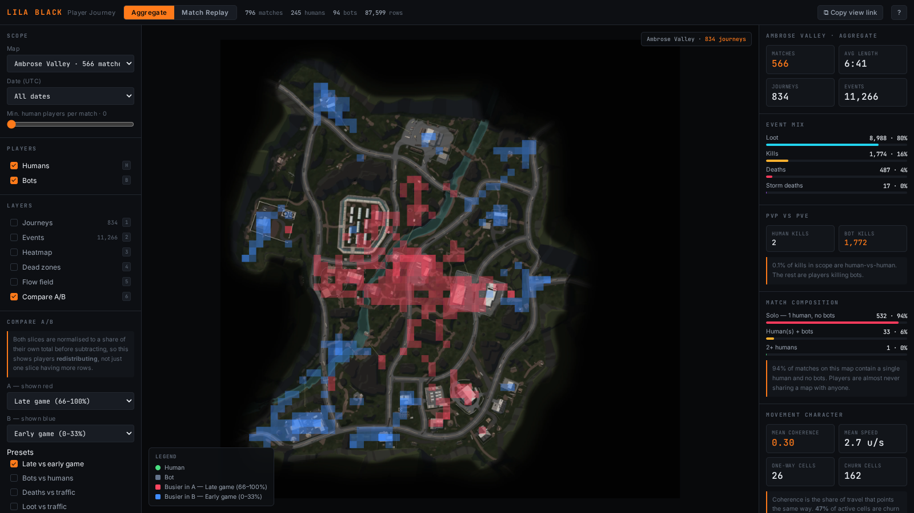

# What I learned about LILA BLACK

The brief asked for three. The fourth came out of the flow-field and compare layers after they were built, and it changes what to do about the second — so it is here too.

All figures are from the full dataset — **1,243 files, 89,104 rows, 796 matches, 245 humans, 94 bots, Feb 9–14 2026 (UTC)** — read through the tool in this repo. Every claim below is reproducible from a link in the tool itself.

> **One caveat up front, stated honestly.** Each file is one player in one match, and matches are joined on `match_id`. If production telemetry only samples a subset of players per match, Insight 1 would be an artefact of sampling rather than a property of the game. I've flagged the test that distinguishes the two. Insights 2 and 3 hold either way, because they're measured *within* a player's own session.

---

## Insight 1 — The PvPvE extraction shooter has almost no PvP in it

**What caught my eye**

I built Replay mode expecting to watch players converge and fight. Instead, nearly every match I loaded had exactly one green dot moving around an empty island. I thought the filter was broken. It wasn't.

**The evidence**

| Measure | Value |
|---|---|
| Matches with **1 human and 0 bots** | **743 / 796 — 93.3 %** |
| Matches containing **2+ humans** | **1 / 796** |
| Matches containing **any bot** | 52 / 796 — 6.5 % |
| `Kill` (human killed a human) | **3** |
| `BotKill` (human killed a bot) | 2,376 |
| **Human-vs-human share of all kills** | **0.13 %** |
| Loot share of all discrete events | **78.9 %** |

Open the tool → Aggregate → any map → the **Match composition** panel. It's the same story on all three: Ambrose Valley 93 % solo, Grand Rift 90 %, Lockdown 94 %.

The Play Store page sells "outplay enemies", "PvPvE", "interact with up to 20 other players". What the telemetry records is a **solo looting simulator**. The average player's entire session is: drop in, pick up ~14 items, kill 2–3 bots, leave. They never see another human being.

**Is it real, or is it the telemetry?**

The decisive test: if 10 humans genuinely shared a match, we'd expect many `match_id`s appearing in ~10 files. We see exactly **one** `match_id` shared by two humans in five days. Either matchmaking is genuinely placing players alone, or per-match telemetry is being written for only one participant. **That ambiguity is itself the finding** — and it should take about ten minutes to resolve by checking whether the server writes a row per participant or per session owner.

**Actionable**

1. **Resolve the ambiguity first** — one query against the match service. Everything below depends on it.
2. If it's real: this is a **matchmaking/liquidity problem, not a level-design problem**. At this concurrency the honest fix is to backfill lobbies with bots aggressively — right now 93.5 % of matches have *neither* humans nor bots to fight. The genre's core tension (another player might be around that corner) is simply absent.
3. If it's sampling: **the telemetry is not fit for level-design work** and should be fixed before anyone draws a heatmap from it — including every heatmap in this tool. Worth knowing before a map gets rebalanced on bad data.
4. Either way: **bots are currently the entire combat experience.** Their placement, density and difficulty deserve the attention currently being spent on PvP sightlines.

**Metrics affected**

Human-vs-human engagement rate per match · time-to-first-contact · fights per session · match concurrency / lobby fill rate · perceived match pacing → **session length, D1/D7 retention, and the "is this game exciting" question that drives every one of them.**

**Why a level designer should care**

Chokepoints, sightlines and cover only matter if two players meet. Today they don't. Any PvP-balancing work on these maps is being validated against three data points. Before tuning a single angle, a designer needs to know whether they're designing for an empty island.

---

## Insight 2 — The storm, the genre's core pressure mechanic, is decorative in 4 out of 5 matches

**What caught my eye**

Storm deaths were so rare I initially thought I'd mis-decoded the event. Then I scrubbed the timeline and saw why: the storm arrives **after most matches have already ended.**

**The evidence**

| Measure | Value |
|---|---|
| `KilledByStorm` events in 5 days | **39** |
| Storm's share of all deaths | **5.3 %** |
| **Earliest** storm death, match-relative | **t = 655 s (10:55)** |
| Median storm death | t = 739 s (12:19) |
| **Median match duration** | **382 s (6:22)** |
| Matches that last past 655 s | **140 / 796 — 17.6 %** |
| Matches that end *before* any storm can kill | **82.4 %** |

Storm deaths cluster tightly in **time** (σ ≈ 57 s) but are scattered all over the map in **space** — consistent with the one-directional, time-driven storm described in the dataset README. The pressure is real; it just starts after four out of five players have already gone home.

**Actionable**

1. **Pull the storm's first contact forward to ~4:00–5:00**, inside the window where 80 % of matches actually live. Right now the mechanic that's supposed to force movement and create endgame collisions only fires for the longest-tail 17.6 % of sessions.
2. This is also the **cheapest available lever on Insight 1**. A storm that compresses the playable area early is the standard genre tool for manufacturing player collisions without needing more concurrency. It squeezes a sparse population into shared space.
3. **Instrument the storm properly.** Only deaths are logged — not the ring's centre or radius over time. Without that, nobody can answer "was this death fair?" or "did the storm push players somewhere interesting?". This is the second-highest-value column to add (see Insight 3 for the first).
4. Re-measure after the change: storm deaths should rise, but if they exceed ~15 % of deaths it's gone from "pressure" to "punishment".

**Metrics affected**

Match duration distribution · % of matches reaching endgame · player collisions per match · deaths-by-cause mix · **session length and end-of-match sentiment → retention.**

**Why a level designer should care**

Level designers build maps around a shrinking-zone assumption: rotation routes, late-game cover, final-circle terrain. If 82 % of matches never reach the storm, **all of that endgame geometry is being designed for a phase that almost never happens**, while the first six minutes — which is the whole game for most players — gets comparatively little attention.

---

## Insight 3 — Grand Rift is the least-played map, and half the level is ignored anyway

**What caught my eye**

Switching the Dead Zones layer on for each map, Grand Rift lights up almost entirely red. The named points of interest the art team built — **Burnt Zone, Maintenance Bay, Gas Station, Engineer's Quarters** — sit inside the dead area. Players funnel down a narrow spine through the centre (Cave House → Mine Pit) and ignore the rest.

**The evidence**

| Map | Share of matches | Reachable area **ignored** | Top 10 % of cells hold |
|---|---|---|---|
| Ambrose Valley | **71.1 %** | 25 % | 53 % of human traffic |
| Lockdown | 21.5 % | 31 % | 51 % of human traffic |
| **Grand Rift** | **7.4 %** | **48 %** | 49 % of human traffic |

"Ignored" = reachable grid cells (64×64, morphologically closed from the observed-traffic footprint, so the ocean and off-island void are excluded) receiving under 0.5 % of peak traffic. Method in `ARCHITECTURE.md` §3.

Two compounding problems:

- **Grand Rift gets 7.4 % of all matches** — one match for every ten on Ambrose Valley. It's barely in rotation.
- **Of the players who do go, half the level never gets walked on.** It has the worst utilisation of the three maps while receiving the least traffic to begin with.

Note the healthy signal too: traffic concentration is near-identical across all three maps (top 10 % of cells ≈ 50 % of traffic). That's normal — players follow loot and roads everywhere. Grand Rift's problem isn't that players concentrate; it's **how much of the built level sits outside the concentration.**

**Actionable**

1. **Shrink Grand Rift's playable bounds** to roughly the lit corridor, or **move loot density into the dead POIs** to create a reason to go. Right now Burnt Zone and Maintenance Bay are art assets with no gameplay pull. Loot is 79 % of all player actions — **loot placement is the strongest steering tool available**, and it's currently pointed at the middle of the map.
2. **Audit the map rotation weighting.** A 10:1 skew toward Ambrose Valley means two-thirds of the studio's level-art investment is being seen by a fraction of sessions. If the skew is deliberate, fine; if it's a rotation-weight bug, it's a free content multiplier.
3. **Use the region tool before committing.** `Shift`+drag any POI to get its kill/death/loot counts and traffic share. Validate "is this building worth the art budget?" with a number instead of an opinion.
4. **Add the extraction event.** The single most valuable missing column — see below.

**The missing column**

The event vocabulary is `Position`, `BotPosition`, `Kill`, `Killed`, `BotKill`, `BotKilled`, `Loot`, `KilledByStorm`. For an **extraction** shooter, the defining outcome — *did the player get out with their loot?* — **is not recorded at all.**

Without it, nobody can measure extraction rate by zone, compare successful versus failed exfil routes, or tell a player who left voluntarily from one who rage-quit. I deliberately did **not** infer extraction from "positions stopped", because that's indistinguishable from a disconnect and would have put a fabricated number in a designer's hands.

Adding one `Extracted` event would unlock the most important map-design question in the genre: **which exits are viable, and which are traps.**

**Metrics affected**

Map rotation share · area utilisation per map · loot-per-run · art-asset ROI · route diversity · (once instrumented) **extraction success rate — the headline retention and monetisation metric for the genre, since extraction is what converts a run into progression.**

**Why a level designer should care**

This is the most directly actionable finding here. It names specific POIs that aren't earning their place, quantifies how much of each level is unused, and gives a concrete lever — loot placement — that's already proven to move players, since looting is 79 % of everything they do.

---

## Insight 4 — Players already collapse toward the map centre on their own. The storm is not doing it, and it is not needed to.

**What caught my eye**

Turning on **Compare A/B** with *Late game* vs *Early game* produces the same picture on every map: a blue ring around the edge and a solid red core. Players start dispersed and end up concentrated in the middle. The obvious explanation is the storm — that is what storms are for.

The obvious explanation is wrong.

**The evidence**

Mean dispersion of human position samples (average distance from the phase centroid, in UV units, so 0.25 ≈ a quarter of the map):

| Map | Early | Mid | Late | Change |
|---|---|---|---|---|
| Ambrose Valley | 0.290 | 0.216 | 0.176 | **−39.2 %** |
| Grand Rift | 0.253 | 0.209 | 0.201 | **−20.8 %** |
| Lockdown | 0.232 | 0.193 | 0.179 | **−23.0 %** |

Monotonic on all three maps. So far this is consistent with a storm squeezing players inward.

Now the control. The earliest storm death anywhere in the dataset is **t = 655 s** (Insight 2). Split the matches on that line:

| Map | Matches **ending before 655 s** — storm impossible | Matches lasting past 655 s — storm possible |
|---|---|---|
| Ambrose Valley | **−40.0 %** | −36.1 % |
| Grand Rift | **−22.8 %** | −12.6 % |
| Lockdown | **−24.6 %** | −20.7 % |

In the 656 of 796 matches (82.4 %) where the storm *cannot* have influenced anything, the convergence is **just as strong — slightly stronger**. It is not the storm. It is the loot gradient: the dense central town is where the loot is, looting is 79 % of all player actions, and players walk to it.

The flow field says the same thing from the other direction. Mean coherence on Ambrose Valley is **0.30**, with **162 churn cells against 26 true one-way routes** — a 6:1 ratio. Players are not being *routed* anywhere. They drift to the middle and then mill around inside it.

**Is it actionable? Yes — and it makes Insight 2 cheaper to act on.**

Insight 2 recommended pulling first storm contact forward to ~4:00–5:00. The worry with any change like that is that it fights the players. This says it will not: **the storm would be reinforcing a movement players already make unprompted.** It is a tailwind, not a correction. That materially lowers the risk of the change.

Two further actions fall out of it:

1. **Stop treating the centre as the destination and start treating it as the arena.** Players reliably arrive there by the final third with no prompting. That is the one moment the sparse population of Insight 1 is naturally co-located — the only place and time PvP can realistically happen today. Late-game loot, objectives and extraction points belong there.
2. **The 6:1 churn-to-route ratio is the number to move.** Real extraction shooters are built on committed rotations — players picking a route and being punished for reconsidering. Ambrose Valley currently reads as one big open field players wander across. Raising coherence on the approach lanes (cover, one-way drops, narrowed sightlines) is a concrete level-design brief with a measurable before/after, and the Compare layer is how you would check it.

**Metrics affected**

Time-to-first-contact · PvP encounter rate · late-game engagement density · storm-death rate (should rise from 5.3 % toward a genre-normal 10–15 % without feeling arbitrary) · route coherence per lane · area utilisation in the final third.

**Why a level designer should care**

It separates a correlation from a cause, and the direction of the answer changes the decision. Had the storm been driving convergence, moving it earlier would have been a risky lever on the one mechanic that was working. It is not driving it — the level's own loot layout is — which means the storm is pure upside and the real design surface is the approach lanes into the centre, not the storm curve.

**How to see it in the tool**

- `?mode=aggregate&map=AmbroseValley&cmp=traffic_late~traffic_early&nopaths=1&noevents=1` — the red core and blue ring.
- `?mode=aggregate&map=AmbroseValley&flow=0.30&nopaths=1&noevents=1` — the flow field; note how few arrows survive the coherence filter.
