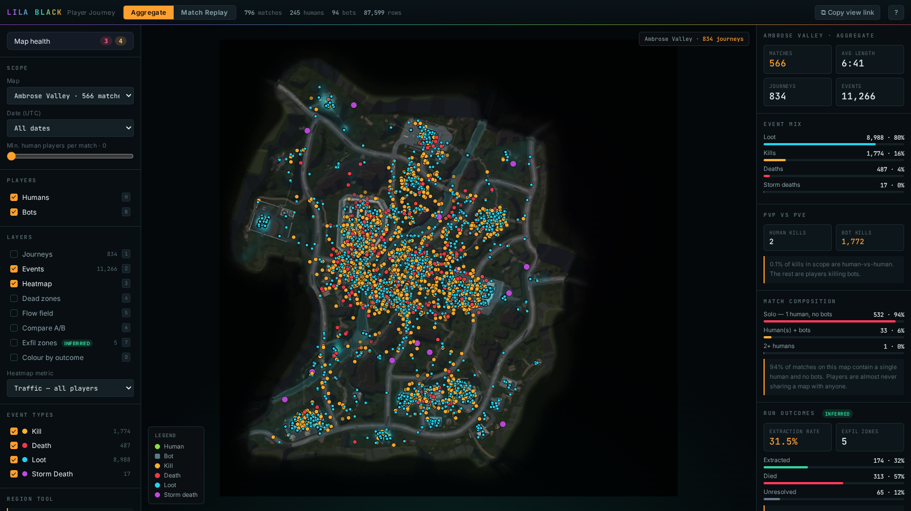
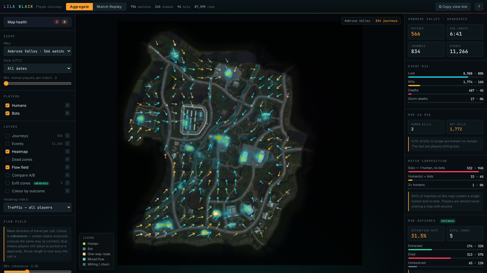
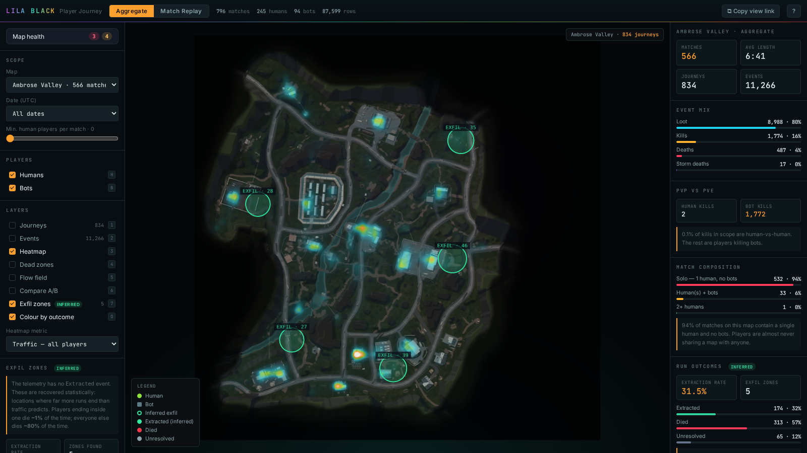
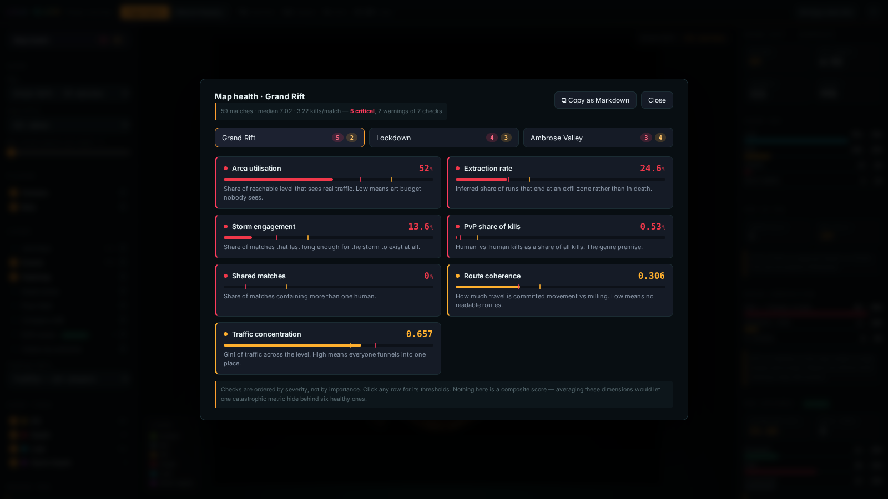

# LILA BLACK — Player Journey Visualisation

A browser tool that turns 5 days of raw LILA BLACK telemetry into something a **Level Designer** can actually open and use: player paths drawn on the real minimaps, kill/death/loot/storm events as distinct markers, heatmaps, dead-zone detection, and a scrubbable match replay.

### ▶ Live tool — _(deployed URL goes here)_
### 🎥 Walkthrough video — _(Loom link goes here)_



<table>
<tr>
<td width="50%"><br><sub><b>Flow field</b> — mean direction of travel per cell, coloured by coherence. Amber is a one-way route, blue is players milling.</sub></td>
<td width="50%"><br><sub><b>Compare A/B</b> — late game vs early game. Red core, blue ring: players converge on the centre. See <code>INSIGHTS.md</code> §4.</sub></td>
</tr>
<tr>
<td width="50%"><br><sub><b>Exfil zones</b> — extraction points recovered from exit clustering, because the telemetry never logged them. See <code>INSIGHTS.md</code> §5.</sub></td>
<td width="50%"><br><sub><b>Map health scorecard</b> — seven checks, severity-ranked, thresholds visible, exportable as Markdown.</sub></td>
</tr>
</table>

---

## What it does

| | Feature |
|---|---|
| **Two modes** | **Aggregate** — heatmaps and statistics across hundreds of matches. **Match Replay** — one match, animated, with a timeline. They're different jobs, so they're different screens. |
| **Player journeys** | Every path projected onto the correct minimap with the world→pixel transform verified against map landmarks (see `ARCHITECTURE.md` §3). |
| **Humans vs bots** | Humans are bright green circles with thicker paths; bots are dimmed slate squares with thin paths. Distinguishable at a glance, toggleable with `H` / `B`. |
| **Event markers** | Kill (amber), Death (red), Loot (cyan), Storm death (violet) — consistent across markers, legend, filters and timeline. |
| **Filtering** | By map, by UTC date, by match, and by minimum human players per match. |
| **Timeline playback** | Play/pause, 1×–16× speed, scrub, frame-step. The scrubber track has an **event-density histogram** baked in, so you can see where the action is and click straight to it. |
| **Heatmaps** | Traffic (all / humans only), kill zones, death zones, loot density, storm deaths. |
| **Flow field** | Movement **direction**, not just density. Each cell shows the mean heading of players crossing it, coloured by **coherence** (`\|Σv\| / Σ\|v\|`) — amber = a one-way corridor everyone traverses the same way, blue = a pocket where players mill about. A heatmap says *where*; this says *which way*, which is what "map flow" actually means. |
| **Compare A/B** | A divergent diff of any two slices of the map — late vs early game, bots vs humans, deaths vs traffic. Both sides are normalised to a share of their own total before subtracting, so it shows players **redistributing** rather than one slice simply having more rows. Red = busier in A, blue = busier in B. This is the "did the change work?" view, applied to level design. |
| **Exfil zones** <sup>inferred</sup> | The dataset has **no extraction event**. These are recovered statistically — locations where 13–47× more runs end than traffic predicts. Validated against an independent signal: players ending inside one die **0.6 %** of the time, everyone else dies **82.8 %** of the time. Gives LILA an **extraction rate** (~27 %) that was previously unmeasurable. See `ARCHITECTURE.md` §3c. |
| **Map health scorecard** | Seven checks per map — utilisation, route coherence, traffic concentration, extraction rate, storm engagement, PvP share, shared matches — each flagged ok/warn/critical with visible thresholds, ranked by severity, and exportable as Markdown for a ticket. The tool volunteers problems instead of waiting to be interrogated. |
| **Dead zones** | The inverse heatmap — grid cells players effectively never enter. The brief asked "which areas of the map get ignored"; this answers it directly. |
| **Region tool** | `Shift`+drag any area to get its kill/death/loot counts and traffic share. "Is this building pulling its weight?" |
| **Shareable views** | Every filter, layer, match and timestamp lives in the URL. **Copy view link** puts the exact screen in a colleague's hands. |
| **Movement character** | Headline read-out of the flow field: mean coherence, mean speed in world units/second, and the split between true routes and churn cells. |
| **Coordinate debug** | `Ctrl`/`⌘`+`D` overlays a live world-coordinate grid so the projection can be audited without reading code. |

---

## Visual design

The palette is sampled from the LILA BLACK key art in the assignment brief — teal atmosphere, magenta vortex, lime foliage, amber jacket, crimson eye. The mapping is semantic as well as decorative: the **storm marker is the vortex magenta**, the **death marker is the tower's eye**. Brand colours are confined to the wordmark, header and background glow; they never encode data. Details in `ARCHITECTURE.md` §3e.

---

## Tech stack

**Pipeline:** Python 3 · PyArrow · pandas · NumPy · Pillow
**Frontend:** React 18 · TypeScript · Vite · deck.gl 9 (`OrthographicView`) · Zustand
**Hosting:** static build, deployed to Vercel. No backend, no database, no API keys.

Full reasoning and trade-offs in **[`ARCHITECTURE.md`](ARCHITECTURE.md)**.
Three findings from using the tool in **[`INSIGHTS.md`](INSIGHTS.md)**.
Every row the pipeline dropped and why in **[`pipeline/DATA_QUALITY.md`](pipeline/DATA_QUALITY.md)**.

---

## Repository layout

```
.
├── pipeline/
│   ├── build.py              raw parquet -> web/public/data/bundle.json
│   ├── prepare_maps.py       24 MB of source minimaps -> 0.73 MB of WebP
│   ├── requirements.txt
│   └── DATA_QUALITY.md       generated: every dropped row, by reason
├── web/
│   ├── src/
│   │   ├── components/       MapView · LeftPanel · RightPanel · Timeline
│   │   ├── lib/              viz.ts (projection + palette) · useFiltered.ts
│   │   ├── store.ts          Zustand store
│   │   ├── types.ts
│   │   └── App.tsx           layout · URL state · keyboard shortcuts
│   └── public/
│       ├── data/bundle.json  generated
│       └── maps/*.webp       generated
├── docs/
├── ARCHITECTURE.md
├── INSIGHTS.md
└── README.md
```

---

## Setup

### Prerequisites
Node 20+, Python 3.10+

### 1. Get the data
Download `player_data.zip` and unpack it so you have:

```
player_data/
├── February_10/ … February_14/     *.nakama-0 parquet shards
└── minimaps/                       AmbroseValley_Minimap.png, GrandRift_Minimap.png, Lockdown_Minimap.jpg
```

### 2. Run the pipeline
```bash
pip install -r pipeline/requirements.txt

python pipeline/prepare_maps.py --input player_data/minimaps --out web/public/maps
python pipeline/build.py        --input player_data          --out web/public/data
```

`build.py` prints a summary and writes `pipeline/DATA_QUALITY.md`. Both outputs are committed, so you can skip this and go straight to step 3.

### 3. Run the app
```bash
cd web
npm install
npm run dev          # http://localhost:5173
```

### 4. Build for production
```bash
cd web
npm run build        # -> web/dist
npm run preview
```

### Environment variables
**None.** The tool is fully static and has no secrets or external services.

### Deploying
Vercel: point it at the repo, set **Root Directory** to `web`. Framework preset Vite, build `npm run build`, output `dist`. Netlify/Cloudflare Pages/GitHub Pages work identically — it's just static files.

---

## Keyboard shortcuts

| Key | Action |
|---|---|
| `Space` | Play / pause (Replay mode) |
| `←` `→` | Step 1 second · `Shift` for 10 |
| `1` `2` `3` `4` | Toggle journeys / events / heatmap / dead zones |
| `5` `6` `7` | Toggle flow field / compare A-B / exfil zones |
| `M` | Map health scorecard |
| `O` | Colour journeys by inferred outcome |
| `H` / `B` | Toggle humans / bots |
| `R` | Switch Aggregate ⇄ Replay |
| `Shift` + drag | Measure a region |
| `Ctrl`/`⌘` + `D` | Coordinate debug grid |
| `Esc` | Clear selection & region |
| `?` | Shortcut reference |

---

## Data notes worth knowing

Three things in the dataset will silently produce a wrong tool if taken at face value. All three are handled here and documented in `ARCHITECTURE.md` §3–4:

1. **`ts` is not what the README says it is.** It's typed `timestamp[ms]` and described as match-relative. The int64 is actually **epoch seconds** — read literally, every match happens on 1970-01-21 and lasts 0.4 seconds.
2. **The minimaps are not 1024×1024.** They're 4320², 2160×2158 and 9000², and one isn't square. The pipeline works in resolution-independent UV space.
3. **The day folders are not UTC days.** Matches straddle midnight, so `February_10/` contains Feb 9 rows. Filtering by folder name is wrong; the date filter uses the derived timestamp.
