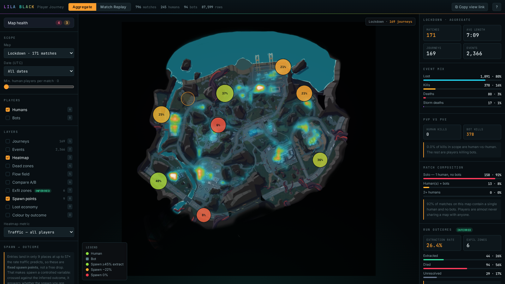
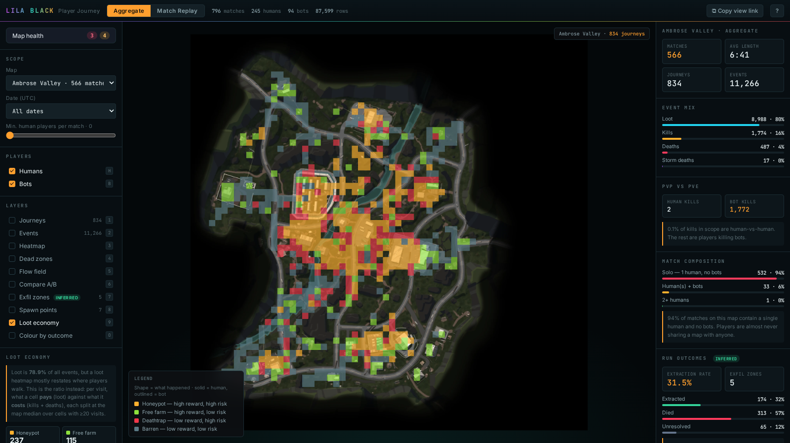

# LILA BLACK — Player Journey Visualisation

A browser tool that turns 5 days of raw LILA BLACK telemetry into something a **Level Designer** can actually open and use: player paths drawn on the real minimaps, kill/death/loot/storm events as distinct markers, heatmaps, dead-zone detection, and a scrubbable match replay.

### ▶ Live tool — _(deployed URL goes here)_
### 🎥 Walkthrough video — _(Loom link goes here)_


<table>
<tr>
<td width="50%"><br><sub><b>Flow field</b> — mean direction of travel per cell, coloured by coherence. Amber is a one-way route, blue is players milling.</sub></td>
<td width="50%"><br><sub><b>Compare A/B</b> — late game vs early game. Red core, blue ring: players converge on the centre. See <code>INSIGHTS.md</code> §4.</sub></td>
</tr>
<tr>
<td width="50%"><br><sub><b>Exfil zones</b> — extraction points recovered from exit clustering, because the telemetry never logged them. See <code>INSIGHTS.md</code> §5.</sub></td>
<td width="50%"><br><sub><b>Map health scorecard</b> — seven checks, severity-ranked, thresholds visible, exportable as Markdown.</sub></td>
</tr>
<tr>
<td width="50%"><br><sub><b>Spawn → outcome</b> — Lockdown's fixed spawns, coloured by extraction rate. The red 6 % spawn against the lime 40 % is a 6.4× fairness gap. See <code>INSIGHTS.md</code> §6.</sub></td>
<td width="50%"><br><sub><b>Loot economy</b> — reward per visit against risk per visit. Amber honeypots in the town core, red deathtraps, slate barren ground.</sub></td>
</tr>
</table>

---

## What it does

Eight features. Four are the reason this is worth your time, two more extend the
same thinking into the two ends of a run that nothing else measures, and two are
the foundation they all stand on.

### The four

| | Feature | What it answers | Why it exists |
|---|---|---|---|
| 1 | **Exfil Intelligence** <sup>inferred</sup> | *Where do players actually get out?* | The telemetry has **no extraction event** — the defining outcome of an extraction shooter is unrecorded. These zones are recovered statistically: locations where 13–47× more runs end than traffic predicts, validated against an independent signal (players ending inside one die **0.6 %** of the time; everyone else dies **82.8 %**). Produces an **extraction rate** (~27 %) that was previously unmeasurable. `ARCHITECTURE.md` §3c |
| 2 | **Rotation & Flow Field** | *Which way do players move, and is it a route or a wander?* | A heatmap says *where*. This says *which way*, per cell, coloured by **coherence** = `\|Σv\| / Σ\|v\|` — amber is a one-way corridor, blue is milling. Rotations are a first-class table in real battle-royale warehouses, not an afterthought. `ARCHITECTURE.md` §3b |
| 3 | **Phase Compare (A/B)** | *Did the distribution of players actually move?* | Divergent diff of any two slices — late vs early game, bots vs humans, deaths vs traffic. Both sides are normalised to a share of their own total **before** subtracting, so it measures redistribution rather than sample size. `ARCHITECTURE.md` §3b |
| 4 | **Map Health Scorecard** | *What's wrong with this map, without me going to look?* | Seven checks per map, severity-ranked, thresholds visible and contestable, **every flag clickable straight to the layer that proves it**, exportable as Markdown for a ticket. The only declarative view in the tool. `ARCHITECTURE.md` §3d |

### The two that complete the run

These bookend the four above. Exfil Intelligence found where runs *end*; these
ask what happens at the *start*, and what the map pays you in between.

| | Feature | What it answers | Why it exists |
|---|---|---|---|
| 5 | **Spawn → Outcome Funnel** | *Does the spawn you're handed decide how your run ends?* | Clustering the **first** position of every human journey the way Exfil clusters the last one shows entries landing in only **9–19 cells per map, at 30–57× the rate traffic predicts** — LILA BLACK uses **fixed spawn points**, not a battle-royale free drop. That makes spawn a controlled variable, so it can be crossed against the inferred outcome. The result is a fairness number: Ambrose is balanced (**1.37×** spread between best and worst spawn), **Lockdown is not — 6.4×**, with its worst spawn extracting **6 %** on a 2:34 median run against **40 %** and 7:07 for its best. Zones under 10 runs are drawn hollow and refused a ranking. `ARCHITECTURE.md` §3f |
| 6 | **Loot Economy** | *Per unit of footfall, what does a cell pay, and what does it cost?* | Loot is **78.9 %** of all recorded events and the biggest lever a Level Designer actually controls, but a loot heatmap mostly restates where players walk (**r = 0.80** against traffic on Ambrose). This is the ratio instead — reward `loot/visit` against risk `(kills+deaths)/visit`, each split at the map median — giving the four-way **honeypot / free-farm / deathtrap / barren** classification loot-balance teams work from. It surfaces **262 loot deserts** on Ambrose: cells with 20+ visits that pay nothing at all. `ARCHITECTURE.md` §3g |

### The two it stands on

| | Feature | Contains |
|---|---|---|
| 5 | **Journey Explorer** | The aggregate workspace: every path on the correct minimap, humans (lime) vs bots (slate), kill/death/loot/storm markers, filtering by map / date / match / player count, six heatmap metrics, **dead-zone detection**, and a `Shift`+drag **region tool** that returns kill/death/loot counts and traffic share for any area. |
| 6 | **Match Replay** | One match animated over its own timeline — play/pause, 1×–16×, scrub, frame-step, with an **event-density histogram baked into the scrubber** so you can see where the action is and click to it. |

Throughout: every filter, layer, match and timestamp lives in the URL, so **Copy view link** puts the exact screen in a colleague's hands. `Ctrl`/`⌘`+`D` overlays a live world-coordinate grid so the projection can be audited without reading code.

---

## Grounding: this is the feature set real studios build

The four headline features weren't invented. They're the standard shape of
battle-royale level-design analytics, checked against how the genre's
practitioners actually work:

| Here | Industry equivalent |
|---|---|
| Exfil zone inference | The COD: Warzone *Caldera* telemetry study analyses player paths **and their endpoint locations**; PUBG analytics warehouses build a `mart_drop_zone` grid mart on the same principle. |
| Rotation & flow field | `mart_player_rotation` is a first-class fact table (player × match) in production PUBG warehouses. |
| Phase compare | `fact_match_phase` (match × zone phase) is standard grain; a midcore studio writing in *PocketGamer.biz* shows the same thing as "movements on the map, different colours for different stages of the level". |
| Map health scorecard | Balance marts — "weapons · drops · zones" — are how balance teams consume telemetry rather than reading raw graphs. |
| Dead zones | The same *PocketGamer.biz* team used heatmaps specifically to find dead ends and under-used routes, then moved spawn points to redirect traffic. |
| Spawn → outcome funnel | PUBG warehouses publish a **"zone luck"** table — drop position cross-tabbed against average finish, survival time and distance travelled. Same question, same shape, asked of fixed spawns instead of a drop plane. |
| Loot economy | Studios running this genre treat loot-spawn rates as a continuous post-launch balance job, tuned from per-event telemetry alongside weapon damage and zone timing — reward-per-visit against risk-per-visit is the grain that job runs on. |

---

## Visual design

The palette is sampled from the LILA BLACK key art in the assignment brief — teal atmosphere, magenta vortex, lime foliage, amber jacket, crimson eye. The mapping is semantic as well as decorative: the **storm marker is the vortex magenta**, the **death marker is the tower's eye**. Brand colours are confined to the wordmark, header and background glow; they never encode data. Details in `ARCHITECTURE.md` §3e.

---

## Tech stack

**Pipeline:** Python 3 · PyArrow · pandas · NumPy · Pillow
**Frontend:** React 18 · TypeScript · Vite · deck.gl 9 (`OrthographicView`) · Zustand
**Hosting:** static build, deployed to Vercel. No backend, no database, no API keys.

Full reasoning and trade-offs in **[`ARCHITECTURE.md`](ARCHITECTURE.md)**.
Three findings from using the tool in **[`INSIGHTS.md`](INSIGHTS.md)**.
Every row the pipeline dropped and why in **[`pipeline/DATA_QUALITY.md`](pipeline/DATA_QUALITY.md)**.

---

## Repository layout

```
.
├── pipeline/
│   ├── build.py              raw parquet -> web/public/data/bundle.json
│   ├── prepare_maps.py       24 MB of source minimaps -> 0.73 MB of WebP
│   ├── requirements.txt
│   └── DATA_QUALITY.md       generated: every dropped row, by reason
├── web/
│   ├── src/
│   │   ├── components/       MapView · LeftPanel · RightPanel · Timeline
│   │   ├── lib/              viz.ts (projection + palette) · useFiltered.ts
│   │   ├── store.ts          Zustand store
│   │   ├── types.ts
│   │   └── App.tsx           layout · URL state · keyboard shortcuts
│   └── public/
│       ├── data/bundle.json  generated
│       └── maps/*.webp       generated
├── docs/
├── ARCHITECTURE.md
├── INSIGHTS.md
└── README.md
```

---

## Setup

### Prerequisites
Node 20+, Python 3.10+

### 1. Get the data
Download `player_data.zip` and unpack it so you have:

```
player_data/
├── February_10/ … February_14/     *.nakama-0 parquet shards
├── minimaps/                       AmbroseValley_Minimap.png, GrandRift_Minimap.png, Lockdown_Minimap.jpg
└── README.md                       (the dataset README — ignored by the pipeline)
```

Put it anywhere; `--input` takes the path. The shard walk is recursive and
filters on the `.nakama-0` suffix, so the sibling `minimaps/` folder and
`README.md` are skipped rather than tripping it up.

### 2. Run the pipeline
```bash
pip install -r pipeline/requirements.txt

python pipeline/prepare_maps.py --input player_data/minimaps --out web/public/maps
python pipeline/build.py        --input player_data          --out web/public/data
```

`build.py` prints a summary and writes `pipeline/DATA_QUALITY.md`. Both outputs are committed, so you can skip this entirely and go straight to step 3.

**This path is verified, not just documented.** Fresh `git clone`, `web/public/data`
and `web/public/maps` deleted outright, the dataset dropped in untouched, then the
two commands above run verbatim. Result:

```
1243 parquet shards → 89,104 rows → 87,599 survive
796 matches, 1242 journeys, 14750 events
spawns · exfil · flow · scorecard · grids   all present
bundle.json  SHA-256 identical to the committed copy
AmbroseValley.webp / GrandRift.webp / Lockdown.webp  byte-identical
```

No environment variables, no credentials, no network access, no manual steps
between the two commands. Runtime is about 20 seconds.

### 3. Run the app
```bash
cd web
npm install
npm run dev          # http://localhost:5173
```

### 4. Build for production
```bash
cd web
npm run build        # -> web/dist
npm run preview
```

### Environment variables
**None.** The tool is fully static and has no secrets or external services.

### Deploying
Vercel: point it at the repo, set **Root Directory** to `web`. Framework preset Vite, build `npm run build`, output `dist`. Netlify/Cloudflare Pages/GitHub Pages work identically — it's just static files.

---

## Keyboard shortcuts

| Key | Action |
|---|---|
| `Space` | Play / pause (Replay mode) |
| `←` `→` | Step 1 second · `Shift` for 10 |
| `1` `2` `3` `4` | Toggle journeys / events / heatmap / dead zones |
| `5` `6` `7` | Toggle flow field / compare A-B / exfil zones |
| `8` `9` | Toggle spawn points / loot economy |
| `M` | Map health scorecard |
| `O` | Colour journeys by inferred outcome |
| `H` / `B` | Toggle humans / bots |
| `R` | Switch Aggregate ⇄ Replay |
| `Shift` + drag | Measure a region |
| `Ctrl`/`⌘` + `D` | Coordinate debug grid |
| `Esc` | Clear selection & region |
| `?` | Shortcut reference |

---

## Data notes worth knowing

Three things in the dataset will silently produce a wrong tool if taken at face value. All three are handled here and documented in `ARCHITECTURE.md` §3–4:

1. **`ts` is not what the README says it is.** It's typed `timestamp[ms]` and described as match-relative. The int64 is actually **epoch seconds** — read literally, every match happens on 1970-01-21 and lasts 0.4 seconds.
2. **The minimaps are not 1024×1024.** They're 4320², 2160×2158 and 9000², and one isn't square. The pipeline works in resolution-independent UV space.
3. **The day folders are not UTC days.** Matches straddle midnight, so `February_10/` contains Feb 9 rows. Filtering by folder name is wrong; the date filter uses the derived timestamp.
